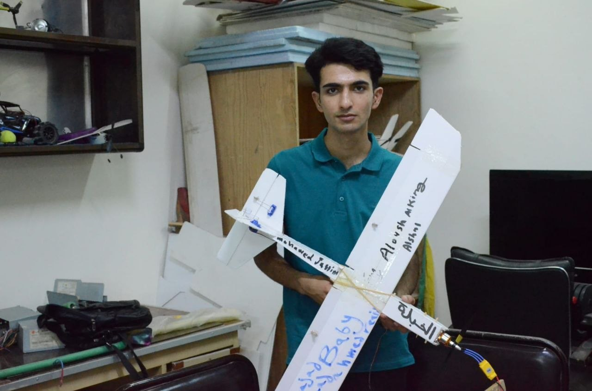
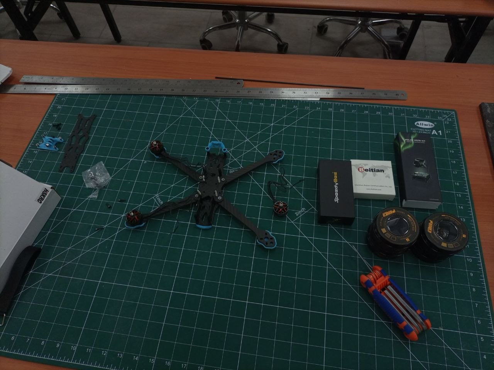
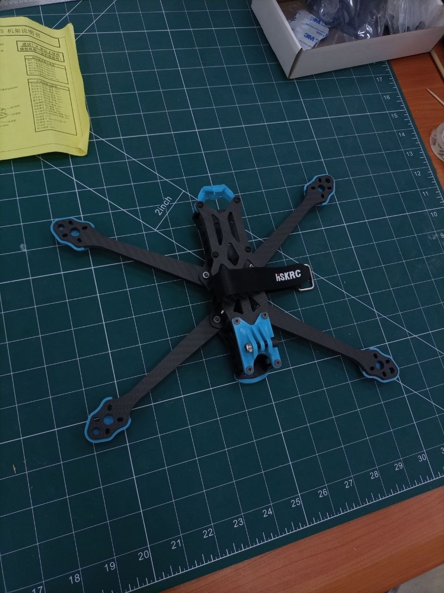
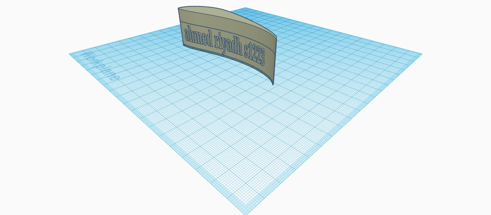
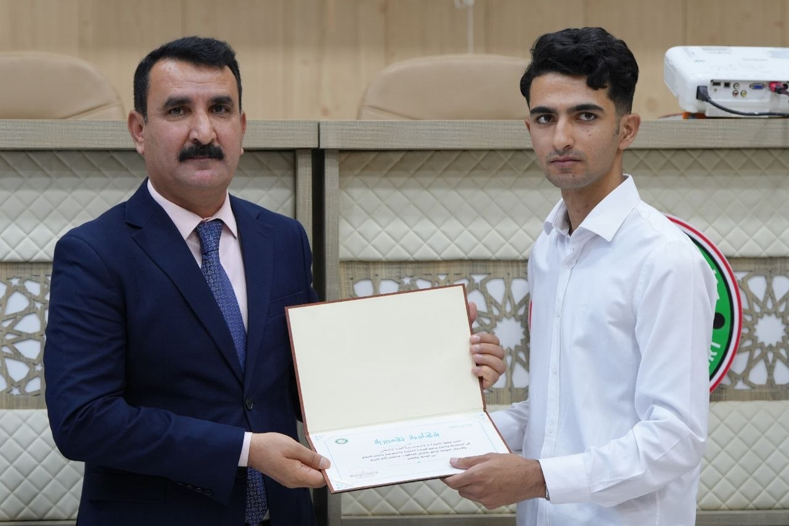

# UAV & Aviation Projects

A collection of hands-on UAV, FPV drone, RC aircraft, and electronics projects developed through engineering practice and volunteer activities.

## What this repository includes

- **RC Aircraft** — practical aircraft construction, electronics integration, and hands-on development.
- **FPV Drone** — frame assembly, component integration, wiring, and flight-controller configuration.
- **CAD / Design** — selected digital design work related to engineering projects.
- **Volunteer & Student Training** — practical workshops and training sessions for students interested in UAVs, FPV drones, RC aircraft, and electronics.

## Project Focus

My work combines aviation electronics, practical fabrication, electronics, UAV systems, and hands-on learning.

The projects shown here are selected documentation of practical work rather than a complete archive.

---

## RC Aircraft

Hands-on RC aircraft construction and electronics integration project.

### My Contribution

- Aircraft construction and assembly
- Component integration and wiring
- Electronics installation
- Flight-control setup
- Testing and troubleshooting

### Project Photo

---

## FPV Drone

Hands-on FPV drone assembly and electronics integration project.

### My Contribution

- FPV frame assembly
- Component integration and wiring
- Motor and ESC installation
- Flight-controller configuration
- Betaflight setup
- Testing and troubleshooting

### Project Photos

---

## CAD / Engineering Design

Selected CAD work related to engineering and UAV projects.

### My Contribution

- 3D/CAD modelling
- Engineering design development
- Digital model preparation

### Project Photo

---

## Volunteer & Student Training

As part of my volunteer activities with the Ministry of Youth and Sports, I participated in practical engineering activities and supported hands-on learning for students through workshops involving UAVs, FPV drones, RC aircraft, and electronics.

### Recognition

---

## Note

This repository contains selected project photos and documentation. Original design files, personal documents, and sensitive project materials are intentionally not included.
